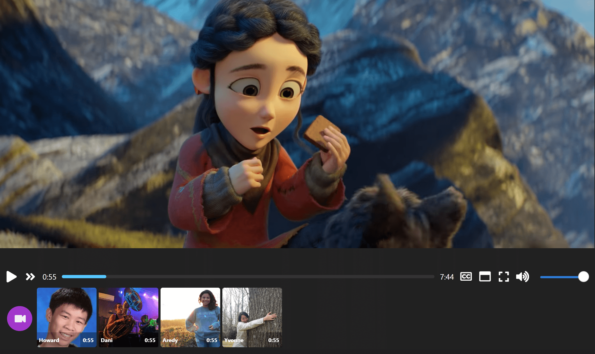

# WebCineTV

Uma plataforma para assistir videos em sincronia com amigos.

## Description

- Synchronizes the video being watched with the current room
- Plays, pauses, and seeks are synced to all watchers
- Supports:
  - Screen sharing (full screen, browser tab or application)
  - Launch a shared virtual browser in the cloud (similar to rabb.it)
  - Stream-your-own-file
  - Video files on the Internet (anything accessible via HTTP)
  - YouTube videos
  - Magnet links (via WebTorrent)
  - .m3u8 streams (HLS)
- Create separate rooms for users on demand
- Text chat
- Video chat

## Quick Start (Desenvolvimento)

1. Entre na pasta do projeto e instale dependencias:
   - `cd projeto-watch`
   - `npm install`
2. Copie `.env.example` para `.env` e preencha as chaves.
3. Rode backend + frontend em um unico terminal:
   - `npm run dev:all`
   - (abre automaticamente `http://localhost:5173` no navegador)

Opcional (sem abrir navegador automaticamente):
- `npm run dev:all:no-open`

Observacao: o backend em desenvolvimento observa apenas `server/`, evitando reinicios indesejados quando o Vite atualiza arquivos do frontend.

Servidor padrao: `http://localhost:8080`  
Frontend padrao: `http://localhost:5173`

## Seguranca de Origem (CORS)

Para ambientes de producao, configure os domínios oficiais do frontend no backend:

- `.env`:
  - `CORS_ALLOWED_ORIGINS=https://webcinetv.app,https://www.webcinetv.app`

Regras atuais:
- Origem autorizada recebe `Access-Control-Allow-Origin`.
- Origem nao autorizada nao recebe `Access-Control-Allow-Origin`.
- Sem header `Origin` (server-to-server/same-origin) segue permitido.

Validacao automatica:
- `npm run test:cors`

Para adicionar um novo dominio oficial:
1. Adicione o dominio em `CORS_ALLOWED_ORIGINS` (separado por virgula, sem barra final).
2. Rode `npm run test:cors`.
3. Valide manualmente no navegador que a origem nova funciona e uma origem externa continua bloqueada.

## Setup Avancado (Opcional)

All of these are optional and the application should work without them. Some functionality may be missing.

### YouTube API (busca)

This project uses the YouTube API for video search, which requires an API key. You can get one from Google [here](https://console.developers.google.com).

Without an API key you won't be able to search for videos via the searchbox.

After creating a **YouTube Data API V3** access, you can create an API key which you can add to your environment variables by copying the `.env.example`, renaming it to `.env` and adding the key to the YOUTUBE_API_KEY variable.

After that restart your server to enable the YouTube API access on your server.

### Firebase (autenticacao + Firestore)

O projeto usa Firebase para login e para persistencia de perfil de assinatura em `users/{uid}`.

To set up, create a new Firebase app (or reuse an old one) from [here](https://console.firebase.google.com/). After creating an application, click on the settings cog icon in the left menu next to "Project overview" and click on project settings. From there, scroll down, create a web application and copy the Firebase SDK configuration snippet JSON data.

No frontend, use preferencialmente as variaveis separadas:
- `VITE_FIREBASE_API_KEY`
- `VITE_FIREBASE_AUTH_DOMAIN`
- `VITE_FIREBASE_PROJECT_ID`
- `VITE_FIREBASE_STORAGE_BUCKET`
- `VITE_FIREBASE_MESSAGING_SENDER_ID`
- `VITE_FIREBASE_APP_ID`

No backend, configure `FIREBASE_ADMIN_SDK_CONFIG` com o JSON da service account.

### Stripe Brasil (BRL, PIX, boleto, cartao)
Configure no `.env`:
- `STRIPE_SECRET_KEY`
- `STRIPE_WEBHOOK_SECRET`
- `VITE_STRIPE_PUBLIC_KEY`
- `STRIPE_PRICE_PREMIUM_MONTHLY`
- `STRIPE_PRICE_PREMIUM_ANNUAL`
- `STRIPE_PRICE_FAMILY_MONTHLY`
- `STRIPE_PRICE_FAMILY_ANNUAL`

Endpoints novos:
- `POST /api/billing/create-checkout-session`
- `POST /api/billing/webhook`
- `GET /api/me/entitlements`

Fluxo:
1. Frontend cria checkout session.
2. Stripe processa pagamento (PIX/boleto/cartao).
3. Webhook atualiza perfil do usuario no Firestore.
4. Entitlements controlam recursos premium no backend e frontend.

### Virtual Browser Setup

This project supports creating virtual browsers (using m1k1o/neko) either on a cloud provider or with Docker containers. For development, Docker is easiest.

- Install Docker: `curl -fsSL https://get.docker.com | sh`
- Make sure you have an SSH key pair set up on the server (`id_rsa` in `~/.ssh` directory), if not, use `ssh-keygen`.
- Configure `DOCKER_VM_HOST_SSH_USER` if `root` is not the correct user
- Note: If your web client is not running on the same physical machine as the server, you will also need to configure `DOCKER_VM_HOST` to a publically-resolvable value (i.e. not localhost)
- If you want to run managed instance pools (whether on cloud or with Docker), configure `VM_MANAGER_CONFIG` and run the vmWorker service.

No MVP BR:
- Links de plataformas com DRM (Netflix, Prime, etc.) sao roteados para o VBrowser.
- Acesso ao VBrowser exige plano Premium/Familia quando Firebase esta ativo.

### Room Persistence

- Configure Postgres by adding DATABASE_URL to your .env file and then setting up the database schema
- This allows rooms to persist between server restarts

## Testes automatizados

- CORS: `npm run test:cors`
- E2E (Playwright): `npm run test:e2e`

Cenarios E2E cobertos:
- Criar sala e entrar.
- Abrir e fechar chat.
- Operar playlist.
- Mobile (320px e 390px): validacao de topbar e modal sem sobreposicao critica.

No CI (`pull_request` para `master`), os testes E2E rodam automaticamente.

## Dependencias e mitigacoes

- `firebase-admin` foi atualizado para `13.x` e cadeia relacionada tambem atualizada.
- `pm2` possui advisory sem fix upstream no momento.
  - Mitigacao operacional recomendada: expor apenas via reverse proxy, restringir porta de admin/process manager e monitorar logs/processos.
- `webtorrent` continua com advisories transitivos sem versao segura oficial no ecossistema atual do pacote.
  - Mitigacao aplicada: feature isolada por flag `VITE_ENABLE_WEBTORRENT` (recomendado `false` em producao).

## Tech

- React
- TypeScript
- Node.js
- Redis
- PostgreSQL
- Docker
- Firebase Auth + Firestore
- Stripe Brasil (PIX, boleto, cartao)

## Dicas de deploy (evitar erro fora do localhost)

- Nao use `VITE_SERVER_HOST=http://localhost:8080` em build de producao.
- Se frontend e backend estao no mesmo dominio, deixe `VITE_SERVER_HOST` vazio.
- Se estao em dominios diferentes, configure `VITE_SERVER_HOST` com a URL publica da API (ex.: `https://api.seudominio.com`).
- Para login Google funcionar em producao, adicione o(s) dominio(s) reais em Firebase Authentication > Settings > Authorized domains.
